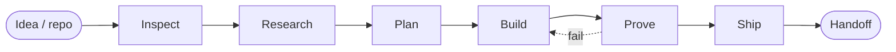

<div align="center">


<br><br>

[](#versioning--one-source-of-truth)
[](LICENSE)
[](https://nodejs.org)
[](#versioning--one-source-of-truth)
[](docs/TESTING.md)
[](docs/AGENT-COMPATIBILITY.md)

### Turn “build me this” into a project that survives week two.

A process harness for coding agents — not a code template, an order of operations.

<sub><b>Inspect → Research → Plan → Build → Prove → Ship → Handoff</b></sub>

</div>

---

## What it is

A skill you install once. After that, every project request — new app, existing repo,
broken build, redesign, audit, release — runs through the same loop: inspect the real
files, verify claims instead of trusting them, plan, build small, prove with a command,
record, hand off.

It is built for the failure mode that actually bites: an agent that produces an
impressive first hour and an unmaintainable second week. So it refuses to claim “done”
without running something, keeps one source of truth for the version, and leaves a
handoff a different agent can continue from.

**It is not** a code generator, a framework, a starter template, or a prompt that makes a
model smarter. It is the order of operations plus the artefacts that make the result
checkable.

---

## Install

```bash
git clone https://github.com/SudhirDevOps1/atlas-skill.git
cd atlas-skill
node scripts/install-skill.mjs --agent claude-code --scope global
```

Replace `claude-code` with `codex`, `cursor`, `antigravity`, `opencode`, `copilot`,
`gemini-cli`, `windsurf`, `cline`, `roo`, `kilo`, `amp`, `warp`, `zed`, `droid`,
`qwen`, `kiro`, `continue`, `openhands`, or `universal`. Run
`node scripts/install-skill.mjs --list` to see the paths.

| Agent | Project | Global |
|---|---|---|
| Claude Code | `.claude/skills/` | `~/.claude/skills/` |
| Codex | `.agents/skills/` | `~/.agents/skills/` |
| Cursor | `.agents/skills/` | `~/.cursor/skills/` |
| Antigravity | `.agents/skills/` | `~/.gemini/config/skills/` |
| OpenCode | `.agents/skills/` | `~/.config/opencode/skills/` |
| GitHub Copilot | `.agents/skills/` | `~/.copilot/skills/` |

Full matrix, chat-UI fallback, updating and troubleshooting:
**[`INSTALL.md`](INSTALL.md)** · per-agent paths and sources:
**[`docs/AGENT-COMPATIBILITY.md`](docs/AGENT-COMPATIBILITY.md)**

Want the skill, the 15-role agent team and four read-only MCP servers in one project?
**[`docs/PROJECT-SETUP.md`](docs/PROJECT-SETUP.md)** — preview first, `--apply` only after
approval.

### What to give the AI

| You give | You get |
|---|---|
| The task | A brief with guessed assumptions |
| Task + `PROJECT-INPUT.md` answers | A brief with far fewer guesses |
| Task + an existing repo | Brownfield audit, then a plan |
| Task + `ATLAS-MASTER-PROMPT.md` | The full rulebook in context — highest token cost |
| Task + `UNIVERSAL-AGENT-PROMPT.md` | A strict approval-first engineer: roles, preservation rules, approval gate, final report |

The skill loads one reference at a time on purpose. Pasting all thirteen costs 10–15× more
context and makes the result worse, not better.

### Then just ask

```text
> ye app banao: <idea>
> is repo ko fix karo
> deploy karna hai
```

The skill triggers on its own. You never have to name it.

### Using the 15-agent team

Installing the skill gives you the rulebook. Installing the team gives you 15 named
specialists. You do **not** pick all 15 yourself: talk to your primary agent and ask it
to delegate 2–4 roles. The primary agent stays the coordinator and owns every handoff.

After the project setup, this is what lands in a project:

| Host | Skill | Agents |
|---|---|---|
| OpenCode | `.agents/skills/atlas-project-architect/` | `.opencode/agents/<id>.md` |
| Antigravity | `.agents/skills/atlas-project-architect/` | `.agents/agents/<id>.md` |

Open a **new agent session** after install. A file on disk is not proof the host loaded
it — confirm the skill and agents are discoverable in that session.

**Load the skill explicitly when you want to be sure:**

```text
@atlas-project-architect
Use this skill for this task. Read SKILL.md and only the references the task needs.
Show me the plan first — no edits yet.
```

`@atlas-project-architect` is the OpenCode form. In other hosts, say
“Use the `atlas-project-architect` skill.”

**Delegate a bounded task:**

```text
@atlas-project-architect
You are the coordinator. Task: <one measurable outcome>.

Delegate:
- api-architect → contract/schema draft (read-only)
- backend-engineer → implementation plan
- qa-engineer → test plan
- code-reviewer → final review

Every report must include command + real output, or NOT RUN with the reason.
No commit, push, tag or deploy until I approve.
```

**Call one specialist directly:**

```text
Use the `security-engineer` subagent to review the auth flow in <path>.
Findings only — do not edit files.
```

| Role | Delegate when |
|---|---|
| `ui-ux-designer` | screens, layout, tokens, flow decisions |
| `frontend-engineer` | component and build work in the detected stack |
| `react-nextjs-engineer` | React/Next.js routing, RSC boundaries, rendering |
| `animation-engineer` | transitions, micro-interactions, scroll motion |
| `backend-engineer` | handlers, workers, services, server logic |
| `api-architect` | endpoint, schema or contract changes |
| `database-architect` | schema, indexes, transactions, RLS, slow queries |
| `security-engineer` | threat model, auth review, dependency audit |
| `qa-engineer` | unit, integration and E2E tests |
| `performance-engineer` | profiling, budgets, query plans |
| `devops-engineer` | CI, containers, hosting, rollback |
| `code-reviewer` | change set ready, before merge |
| `accessibility-engineer` | any UI change or an a11y audit |
| `supply-chain-engineer` | new dependency, publish, licence audit |
| `docs-engineer` | material file changes, before release |

The rules that keep this useful:

- Usually **2–4 roles**, never all 15. One-line snippets and explanations stay in the
  parent thread.
- Review and audit roles are **read-only**. Roles that may write ask permission first.
- A subagent report is **advice**, not authority. The parent verifies it by re-running
  the claimed command.
- No external action, install, migration, deploy, commit or push without explicit
  approval. If it was not run, the report says **NOT RUN**.

Full coordinator loop, delegation packet and handoff contract:
**[`atlas-project-architect/references/11-agent-team.md`](atlas-project-architect/references/11-agent-team.md)**

---

## One-prompt install: Drishti Browser AI

[Drishti Browser AI](https://github.com/SudhirDevOps1/drishti-browser-ai) is a Chrome/Brave
MV3 extension plus a local WebSocket bridge and an MCP server — the agent gets real browser
hands. The prompt below is the whole install: clone from GitHub, build all packages, prove
the build, generate a local token, wire the MCP server into the host, and hand back the two
browser steps that genuinely need a human click.

Give it to Antigravity, OpenCode, Claude Code, Cursor or Codex. Nothing is installed
globally, no OS service is created, and the token never leaves the machine.

```xml
<DRISHTI_ATLAS_INSTALL>
You are installing Drishti Browser AI (दृष्टि) on this machine: a Chrome/Brave MV3
extension + local WebSocket bridge + MCP server. Work step by step. If a step fails twice,
stop and report what you ran, what you saw, and the safest next option. Never guess a path.

0. Preflight — report, do not install anything global:
   - node --version (>= 18), pnpm --version (>= 9), git --version
   - Chrome or Brave installed
   - the clone target must be OUTSIDE the current ATLAS repo

1. Clone the public repo (or use the latest Release ZIP from GitHub Releases):
   git clone https://github.com/SudhirDevOps1/drishti-browser-ai.git <target>
   cd <target>

2. Build and prove it, in this order. Paste the real command and its real result for each:
   pnpm install --frozen-lockfile
   pnpm -r run build
   pnpm test
   pnpm typecheck
   pnpm version:verify
   Confirm apps/chrome-extension/dist/manifest.json exists before continuing.

3. Generate a local auth token and keep it out of git:
   node -e "console.log(require('crypto').randomBytes(32).toString('hex'))"
   Write it to <target>/.drishti-token (already gitignored). Print it once for me.
   Verify with: git check-ignore -v .drishti-token

4. Wire the MCP server into my agent host as mcpServers.drishti-browser-ai:
   command: node
   args: ["<absolute-path>/apps/mcp-server/dist/index.js"]
   env:
     BRIDGE_AUTH_TOKEN: <token from step 3>
     BRIDGE_WS_URL: ws://127.0.0.1:7483
   Show me the exact file you will edit and its full new content BEFORE writing it.

5. Start the bridge on demand only:
   BRIDGE_AUTH_TOKEN=<token> pnpm bridge:start
   Do not create an OS service, a login item, or an auto-start script.

6. Hand me the two steps you cannot do for me:
   a) chrome://extensions -> enable Developer mode -> Load unpacked ->
      select <target>/apps/chrome-extension/dist
   b) Drishti Settings -> Connection & Bridge -> paste the token -> Save Changes ->
      Run Ping -> expect ONLINE

7. Report: every command with its real output, the token file path (never the token value
   in a log), the MCP config path, and anything still NOT RUN.

Hard rules:
- Do not delete, rename or disable any existing Drishti feature, tool, permission or
  screen. All 37 MCP tools stay.
- Do not weaken or skip a test to make a step pass.
- Do not commit the token, node_modules or dist.
- Do not push, tag, publish or open a release without my explicit approval.
- Never bind the bridge to 0.0.0.0; localhost only.
</DRISHTI_ATLAS_INSTALL>
```

**What it deliberately leaves to you.** The agent cannot click “Load unpacked”, cannot grant
a Chrome permission dialog, and cannot decide that a broad host permission is acceptable on
your behalf. Those stay human steps.

**Why this version is stricter than a plain install prompt.** It gates on `pnpm typecheck`
and `pnpm version:verify`, verifies the token is actually gitignored, and forbids deleting a
tool or weakening a test — the three ways an “auto-install” quietly produces a broken or
unsafe setup.

Then hand the agent the domain knowledge it needs:

```text
Use the atlas-project-architect skill.
Read references/12-browser-extension-mcp.md before touching the manifest, the bridge
handshake, or any MCP tool schema.
Then follow docs/DRISHTI-BROWSER-AI-PLAN.md one phase at a time.
No feature, tool or permission removed. No commit or push until I approve.
```

| Document | What it gives the agent |
|---|---|
| [`atlas-project-architect/references/12-browser-extension-mcp.md`](atlas-project-architect/references/12-browser-extension-mcp.md) | MV3 lifecycle, permission budget, message envelope, bridge auth, MCP tool/error contract, regression set, anti-patterns |
| [`docs/DRISHTI-BROWSER-AI-PLAN.md`](docs/DRISHTI-BROWSER-AI-PLAN.md) | The audited findings and the P0–P3 additive plan, with guardrails and acceptance criteria |

---

## The loop



Every claim of “done” carries a command and its real output. If it wasn’t run, it says
**NOT RUN** — there is no third state.

---

## What's inside

| Artifact | What it is | When to use it |
|---|---|---|
| **`atlas-project-architect/`** | The skill — `SKILL.md` + 13 references (10 phase files + skill matrix, agent team, browser/MCP pack) + 6 templates + the version tool | Installed into an agent; loads only the phase it needs |
| **`ATLAS-MASTER-PROMPT.md`** | The full rulebook — 34 sections + appendix | One paste into a capable model when you want the complete contract |
| **`UNIVERSAL-AGENT-PROMPT.md`** | The operating contract — 13 sections: roles, preservation, research, approval policy, final report | Paste when you want approval before every edit; pairs with or without the skill |
| **`docs/SKILL-STACK.md`** | Which outside skill and MCP server to install per domain, per agent | Building the rest of the stack around ATLAS |
| **`scripts/install-skill.mjs`** | Zero-dependency installer for 20 agents | Putting the skill where your agent reads it |
| **`scripts/version.mjs`** (inside the skill) | Zero-dependency SSOT version tool | Any project that ships more than once |

The skill is the operational core. The master prompt is the same thinking, expanded. The
universal prompt is the approval policy — use it when the cost of an unrequested edit is
higher than the cost of one more question.

---

## Versioning — one source of truth

`package.json#version` (or root `version.json`) is the **only** hand-edited version.
Every other surface is generated and marked `AUTO-GENERATED — DO NOT EDIT`.

| Command | Effect |
|---|---|
| `version:bump patch` | `0.1.0` → `0.1.1` |
| `version:bump minor` | `0.1.0` → `0.2.0` |
| `version:bump major` | `0.1.0` → `1.0.0` |
| `version:bump alpha` | `0.1.0` → `0.2.0-alpha.1` |
| `version:bump beta` / `rc` / `stable` | channel promotion |
| `version:set 0.2.0-beta.0` | explicit version |
| `version:sync` | regenerate every derived surface |
| `version:verify` | CI gate — exit `1` on drift |

**Synced surfaces:** app constant · `public/version.json` · README badge · changelog ·
docs front matter · `index.html` meta · OpenAPI · Android `versionName`/`versionCode` ·
Tauri · Expo · Docker label · MEMORY / HANDOFF / status.

Bump is transactional: a failed write restores every file it already touched and exits
`3`. A project without `src/` or `public/` is not given empty scaffolding.

Monorepos: each publishable package keeps its own SSOT. `version:sync --all` is not in
the bundled script — run it per package, or use `pnpm -r run version:sync`.

---

## Repo map

```text
.
├── ATLAS-MASTER-PROMPT.md          full rulebook
├── UNIVERSAL-AGENT-PROMPT.md       approval-first operating contract
├── INSTALL.md                      install in any agent
├── package.json                    SSOT (version) + scripts
├── assets/banner.svg
├── atlas-project-architect/        the installable skill
│   ├── SKILL.md                    trigger + core loop
│   ├── references/                 00 → 12: 10 phase files + 3 packs
│   ├── assets/templates/           AGENTS · MEMORY · HANDOFF · TASKS · ASSUMPTIONS · PROJECT-INPUT
│   └── scripts/version.mjs         SSOT tool
├── scripts/install-skill.mjs       installer for 20 agents
├── tests/                          version.test.mjs · install.test.mjs
├── docs/                           AGENT-COMPATIBILITY · SKILL-STACK · PROJECT-STATUS · TESTING
├── examples/                       greenfield · brownfield audit
├── .github/workflows/ci.yml        Node 20 + 22, tests, drift gate
└── AGENTS · MEMORY · HANDOFF · TASKS · ASSUMPTIONS · SECURITY
```

---

## Compatibility

One `SKILL.md` folder works across agents that implement the
[Agent Skills specification](https://agentskills.io). ATLAS uses only `name` +
`description` front matter, relative file reads, and one plain Node script — no
`allowed-tools`, no `context: fork`, no hooks, no MCP. That is deliberate: the skill
behaves the same everywhere.

Verified against the upstream path table on 2026-11-24:
**[`docs/AGENT-COMPATIBILITY.md`](docs/AGENT-COMPATIBILITY.md)**.

---

## This repo runs on ATLAS

The skill is applied to its own repository — not just documented:

| Practice | Where |
|---|---|
| One source of truth for the version | `package.json` → `version:sync` regenerates the badge, changelog, docs and memory lines |
| Tests before claims | `tests/`, run in CI on Node 20 and 22 |
| Drift gate | CI fails if any generated surface disagrees with the SSOT |
| Continuity | `AGENTS.md` · `MEMORY.md` · `HANDOFF.md` · `TASKS.md` · `ASSUMPTIONS.md` |
| Honest status | [`docs/PROJECT-STATUS.md`](docs/PROJECT-STATUS.md) lists what is not built |
| Case study | [`examples/brownfield-audit.md`](examples/brownfield-audit.md) |

A different agent can pick this up from `HANDOFF.md` alone.

---

## Status

**Tested**

- `version.mjs` — 15 black-box tests: bump / set / sync / verify / show, `--dry-run`,
  drift detection, rollback on write failure, BOM preservation, both SSOT modes.
- `install-skill.mjs` — 8 tests: agent matrix, copy scope, overwrite guard, `--dry-run`,
  project/global resolution, usage errors, self-overwrite guard.
- Both run in CI on Node 20 and 22.

**Not tested**

- Skill behaviour is prompt-level. No automated eval suite exists.

**Deliberately absent**

- No application runtime, database, auth or hosting.
- No PRD or design system in this repo — it ships the process that produces them.

---

<div align="center">

<sub>MIT licensed · <a href="SECURITY.md">security policy</a> · not affiliated with any agent vendor</sub>

</div>
