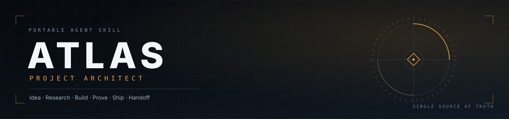

<div align="center">



<br><br>

[](#versioning--one-source-of-truth)
[](https://nodejs.org)
[](#versioning--one-source-of-truth)
[](docs/TESTING.md)
[](#repo-map)

### Turn “build me this” into a project that survives week two.

A process harness for coding agents — not a code template, an order of operations.

<sub><b>Inspect → Research → Plan → Build → Prove → Ship → Handoff</b></sub>

</div>

---

## What's inside

| Artifact | What it is | When to use it |
|---|---|---|
| **`ATLAS-MASTER-PROMPT.md`** | The full rulebook — 34 sections + appendix, 1,400 lines | One paste into a capable model when you want the complete contract |
| **`atlas-project-architect/`** | The portable skill — `SKILL.md` (147 lines) + 11 phase references + 6 templates | Installed into an agent, so it loads only the phase it needs |
| **`scripts/version.mjs`** | Zero-dependency SSOT version tool | Any project that ships more than once |

The skill is the operational core. The master prompt is the same thinking, expanded.

---

## Quick start

### 1 · Install the skill

```powershell
# OpenCode — global
Copy-Item -Recurse .\atlas-project-architect "$env:USERPROFILE\.config\opencode\skills\"

# OpenCode — one project only
Copy-Item -Recurse .\atlas-project-architect .\.opencode\skills\
```

```bash
# Claude Code
cp -r atlas-project-architect ~/.claude/skills/
```

**Cursor / Windsurf** — point `.cursor/rules/atlas.mdc` at `@atlas-project-architect/SKILL.md`.

**Chat UIs** — paste `SKILL.md` as the first message; paste `ATLAS-MASTER-PROMPT.md` when you want the whole rulebook.

### 2 · Ask for a project

```text
> ye app banao: <idea>
> is repo ko fix karo
> deploy karna hai
```

The skill triggers on its own. You never have to name it.

---

## The loop


Every claim of “done” carries a command and its real output. If it wasn’t run, it says **NOT RUN** — there is no third state.

---

## Versioning — one source of truth

`package.json#version` (or root `version.json`) is the **only** hand-edited version. Every other surface is generated and marked `AUTO-GENERATED — DO NOT EDIT`.

| Command | Effect |
|---|---|
| `version:bump patch` | `0.1.0` → `0.1.1` |
| `version:bump minor` | `0.1.0` → `0.2.0` |
| `version:bump major` | `0.1.0` → `1.0.0` |
| `version:bump alpha` | `0.1.0` → `0.2.0-alpha.1` |
| `version:bump beta` / `rc` / `stable` | channel promotion |
| `version:set 0.2.0-beta.0` | explicit version |
| `version:sync` | regenerate every derived surface |
| `version:verify` | CI gate — exit `1` on drift |

**Synced surfaces:** app constant · `public/version.json` · README badge · changelog · docs front-matter · `index.html` meta · OpenAPI · Android `versionName`/`versionCode` · Tauri · Expo · Docker label · MEMORY / HANDOFF / status.

Bump is transactional: a failed write restores every file it already touched and exits `3`.

---

## Repo map

```text
.
├── ATLAS-MASTER-PROMPT.md          full rulebook
├── package.json                    SSOT (version) + scripts
├── assets/banner.svg
├── atlas-project-architect/        the installable skill
│   ├── SKILL.md                    trigger + core loop
│   ├── README.md                   install notes
│   ├── references/                 00 → 10, one per phase
│   ├── assets/templates/           AGENTS · MEMORY · HANDOFF · TASKS · ASSUMPTIONS · PROJECT-INPUT
│   └── scripts/version.mjs         SSOT tool
├── tests/version.test.mjs          15 black-box tests
├── docs/                           PROJECT-STATUS · TESTING
├── .github/workflows/ci.yml        Node 20 + 22, tests, drift gate
└── AGENTS · MEMORY · HANDOFF · TASKS · ASSUMPTIONS
```

---

## This repo runs on ATLAS

The skill is applied to its own repository — not just documented:

| Practice | Where |
|---|---|
| One source of truth for the version | `package.json` → `version:sync` regenerates the badge, changelog, docs and memory lines |
| Tests before claims | `tests/version.test.mjs`, 15 cases, run in CI on Node 20 and 22 |
| Drift gate | CI fails if any generated surface disagrees with the SSOT |
| Continuity | `AGENTS.md` · `MEMORY.md` · `HANDOFF.md` · `TASKS.md` · `ASSUMPTIONS.md` |
| Honest status | [`docs/PROJECT-STATUS.md`](docs/PROJECT-STATUS.md) lists what is not built |

A different agent can pick this up from `HANDOFF.md` alone.

---

## Status

**Tested**

- `version.mjs` — 15 black-box tests: bump / set / sync / verify / show, `--dry-run`, drift detection, rollback on write failure, BOM preservation, both SSOT modes. Run in CI on Node 20 and 22.

**Not tested**

- Skill behaviour is prompt-level. No automated eval suite has been run.

**Not implemented**

- `--all` monorepo iteration and `--force-channel` are specified in the master prompt but absent from the bundled script.

---

<div align="center">
<sub>Personal repository · not a published package · no redistribution license granted</sub>
</div>
